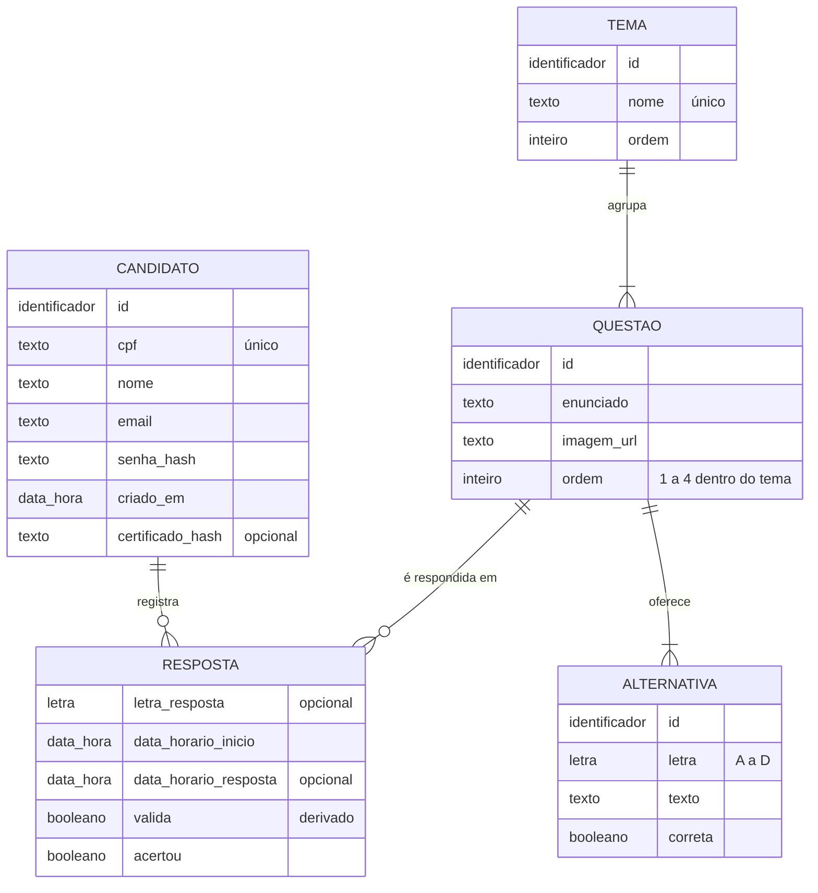
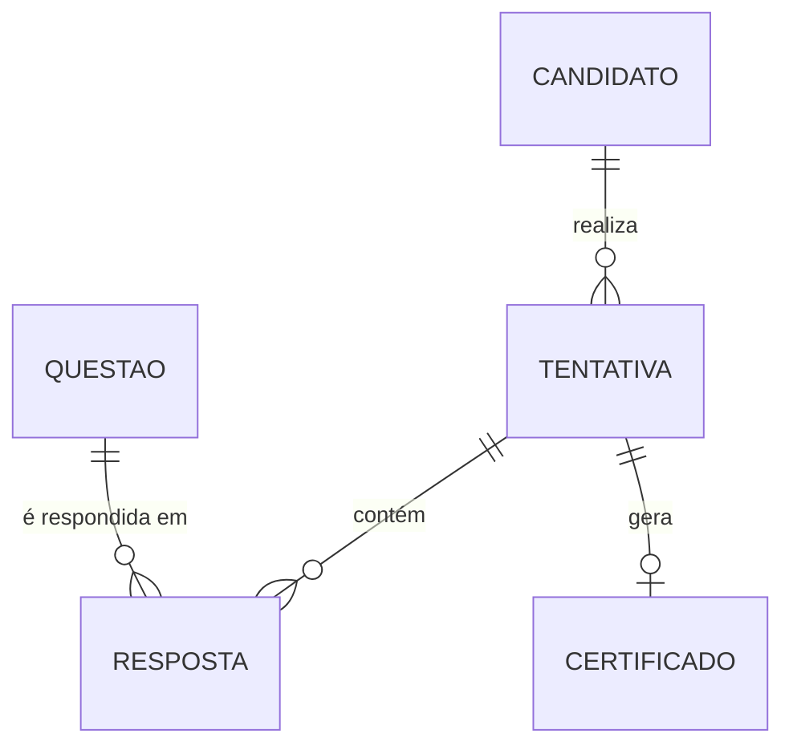

# Modelo conceitual (DER)

Este documento atende ao critério **BD01**: entidades, atributos, identificadores e cardinalidades do domínio de dados da plataforma. O diagrama de casos de uso (`Diagrama/UseCase Diagram1.asta`) descreve o comportamento do sistema. Este DER descreve os **dados**.

## Diagrama

## Entidades

| Entidade | Representa | Identificador |
|---|---|---|
| **Candidato** | Pessoa que se cadastra, estuda e faz a certificação | `id` (natural: `cpf`) |
| **Tema** | Um dos 12 assuntos da certificação | `id` (natural: `nome`) |
| **Questão** | Pergunta de um tema, com imagem de apoio | `id` (natural: `tema` + `ordem`) |
| **Alternativa** | Opção de resposta de uma questão | `id` (natural: `questão` + `letra`) |
| **Resposta** | Associativa: a questão sorteada para um candidato e o que ele respondeu | `candidato` + `questão` |

## Relacionamentos e cardinalidades

| Relacionamento | Cardinalidade | Regra de negócio |
|---|---|---|
| Tema **agrupa** Questão | 1 : N (1,1)–(1,4) | Cada tema tem exatamente 4 questões; cada questão pertence a um único tema |
| Questão **oferece** Alternativa | 1 : N (1,1)–(4,4) | Cada questão tem 4 alternativas (A–D), sendo exatamente 1 correta |
| Candidato **registra** Resposta | 1 : N (1,1)–(0,12) | Um candidato responde no máximo 1 questão por tema, logo até 12 respostas |
| Questão **é respondida em** Resposta | 1 : N (1,1)–(0,N) | A mesma questão pode ser sorteada para vários candidatos |

Candidato e Questão formam um relacionamento **N : M**, resolvido pela entidade associativa **Resposta**, que guarda os dados do próprio evento (horários, letra escolhida, acerto).

## Atributos derivados

- `valida`: verdadeiro quando a resposta foi dada em até 150 segundos após o início (BL-09, BL-14). É calculado a partir de `data_horario_inicio` e `data_horario_resposta`.
- **Percentual de acertos e nota final** (BL-16, BL-17) não são armazenados. São calculados a partir das respostas válidas e corretas.

## Restrições que o modelo não expressa sozinho

- **Uma questão por tema por candidato** (BL-07, BL-08) é garantida pelo backend no sorteio, porque a chave de Resposta é (candidato, questão) e não (candidato, tema).
- **Emissão do certificado só com ≥ 65%** (BL-18) é regra do backend.

## Evolução prevista

Hoje o certificado é um atributo de Candidato (`certificado_hash`), o que permite **uma única tentativa** por candidato. Para suportar várias tentativas e histórico completo (BL-22), a proposta para a Sprint 2 é separar duas entidades:

Essa mudança afeta as rotas de sorteio, resposta e certificado. Por isso precisa ser planejada junto com o backend e não foi aplicada no schema desta correção.

---

[Modelo lógico →](modelo-logico.md) · [Roteiro do banco](README.md)
