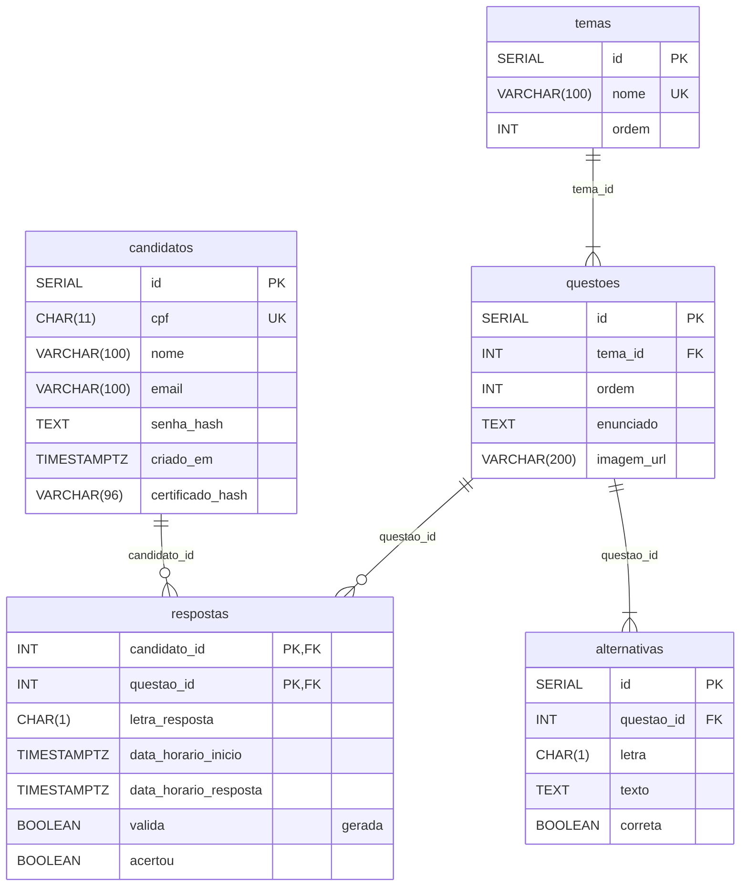

# Modelo lógico, normalização e dicionário de dados

Este documento atende ao critério **BD02**. O modelo físico correspondente é [`backend/database/schemas.sql`](../../backend/database/schemas.sql).

## Esquema relacional

Notação: **sublinhado = chave primária**, *itálico = chave estrangeira*.

- **candidatos** (<u>id</u>, cpf, nome, email, senha_hash, criado_em, certificado_hash)
- **temas** (<u>id</u>, nome, ordem)
- **questoes** (<u>id</u>, *tema_id* → temas.id, ordem, enunciado, imagem_url)
- **alternativas** (<u>id</u>, *questao_id* → questoes.id, letra, texto, correta)
- **respostas** (<u>*candidato_id*</u> → candidatos.id, <u>*questao_id*</u> → questoes.id, letra_resposta, data_horario_inicio, data_horario_resposta, valida, acertou)

## Justificativa de normalização

### 1FN: atributos atômicos, sem grupos repetidos
- As alternativas não estão em colunas `alt_a`, `alt_b`… dentro de `questoes`. Cada alternativa é uma linha em `alternativas`, o que elimina o grupo repetido.
- As respostas de um candidato não estão em uma lista dentro de `candidatos`. Cada resposta é uma linha em `respostas`.
- Todos os atributos guardam um único valor (CPF como 11 dígitos, uma letra por resposta).

### 2FN: sem dependência parcial da chave
- A única tabela com chave composta é `respostas` (candidato_id, questao_id). Todos os seus atributos não-chave (letra escolhida, horários, `valida`, `acertou`) descrevem **aquela resposta daquele candidato para aquela questão**. Nenhum depende só do candidato ou só da questão.
- O enunciado da questão, por exemplo, depende só de `questao_id` e por isso fica em `questoes`, não em `respostas`.
- As demais tabelas têm chave simples (`id`), então não há dependência parcial possível.

### 3FN: sem dependência transitiva
- `questoes` guarda apenas `tema_id`, não o nome do tema. O nome depende do tema, não da questão, e fica em `temas`.
- `respostas` não repete a alternativa correta nem o tema. Ambos são obtidos por junção via `questao_id`.
- `alternativas.correta` depende da própria alternativa (`id`), não de outro atributo não-chave.

### Desnormalizações conscientes
| Atributo | Por que existe | Como se mantém consistente |
|---|---|---|
| `respostas.valida` | Evitar recalcular o prazo de 150 s em toda consulta | Coluna **gerada** (`GENERATED ALWAYS … STORED`): o banco calcula, ninguém grava |
| `respostas.acertou` | Registrar o acerto no momento da resposta, preservando o histórico mesmo que o gabarito seja corrigido depois | Gravado pelo backend no mesmo `UPDATE` que registra a resposta, a partir de `alternativas.correta` |
| `candidatos.certificado_hash` | Simplicidade na 1ª versão (uma tentativa por candidato) | Ver "Evolução prevista" no [modelo conceitual](modelo-conceitual.md#evolução-prevista) |

## Dicionário de dados

### candidatos
| Coluna | Tipo | Nulo | Restrições | Descrição |
|---|---|---|---|---|
| id | SERIAL | não | PK | Identificador interno |
| cpf | CHAR(11) | não | UNIQUE, CHECK só dígitos | CPF sem pontuação, usado no login (BL-01, BL-02) |
| nome | VARCHAR(100) | não | | Nome completo, impresso no certificado (BL-19) |
| email | VARCHAR(100) | não | | E-mail, impresso no certificado (BL-19) |
| senha_hash | TEXT | não | | Hash bcrypt da senha. A senha em texto nunca é gravada |
| criado_em | TIMESTAMPTZ | não | DEFAULT now() | Data/hora do cadastro |
| certificado_hash | VARCHAR(96) | sim | | Código do certificado emitido, usado na validação pública por QR Code (BL-20, BL-21). Nulo = sem certificado |

### temas
| Coluna | Tipo | Nulo | Restrições | Descrição |
|---|---|---|---|---|
| id | SERIAL | não | PK | Identificador interno |
| nome | VARCHAR(100) | não | UNIQUE | Nome do tema (ex.: "Kanban") |
| ordem | INT | não | | Posição do tema na certificação (1 a 12) |

### questoes
| Coluna | Tipo | Nulo | Restrições | Descrição |
|---|---|---|---|---|
| id | SERIAL | não | PK | Identificador interno |
| tema_id | INT | não | FK → temas.id | Tema ao qual a questão pertence |
| ordem | INT | não | CHECK 1–4; UNIQUE (tema_id, ordem) | Posição da questão dentro do tema |
| enunciado | TEXT | não | | Texto da pergunta |
| imagem_url | VARCHAR(200) | não | | Caminho relativo à raiz do repositório, padrão `assets/imagens/tema_T/questao_N.png` |

### alternativas
| Coluna | Tipo | Nulo | Restrições | Descrição |
|---|---|---|---|---|
| id | SERIAL | não | PK | Identificador interno |
| questao_id | INT | não | FK → questoes.id | Questão à qual a alternativa pertence |
| letra | CHAR(1) | não | CHECK A–D; UNIQUE (questao_id, letra) | Letra da alternativa |
| texto | TEXT | não | | Texto da alternativa |
| correta | BOOLEAN | não | DEFAULT false | Indica a alternativa correta (exatamente 1 por questão) |

### respostas
| Coluna | Tipo | Nulo | Restrições | Descrição |
|---|---|---|---|---|
| candidato_id | INT | não | PK, FK → candidatos.id | Quem respondeu |
| questao_id | INT | não | PK, FK → questoes.id | Questão sorteada (BL-07) |
| letra_resposta | CHAR(1) | sim | CHECK A–D | Alternativa marcada. Nulo = não respondeu (BL-13, BL-14) |
| data_horario_inicio | TIMESTAMPTZ | não | DEFAULT now() | Momento em que a questão foi exibida (BL-22) |
| data_horario_resposta | TIMESTAMPTZ | sim | | Momento da resposta (BL-22) |
| valida | BOOLEAN | — | GENERATED STORED | `true` se respondida em até 150 s (BL-09, BL-14) |
| acertou | BOOLEAN | sim | | Resultado da resposta (BL-11, BL-16) |

## Limitação conhecida

A estrutura atual não separa **tentativa** e **certificado**. Com a chave (candidato_id, questao_id), um candidato só pode fazer a prova uma vez e o histórico não distingue tentativas. A proposta de evolução está no [modelo conceitual](modelo-conceitual.md#evolução-prevista).

---

[← Modelo conceitual](modelo-conceitual.md) · [Roteiro do banco](README.md)
